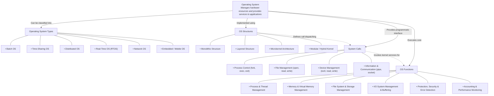
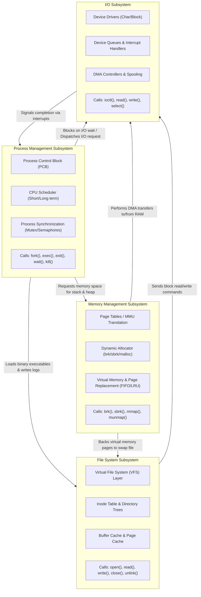
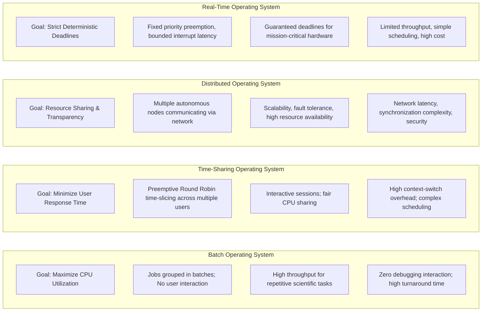
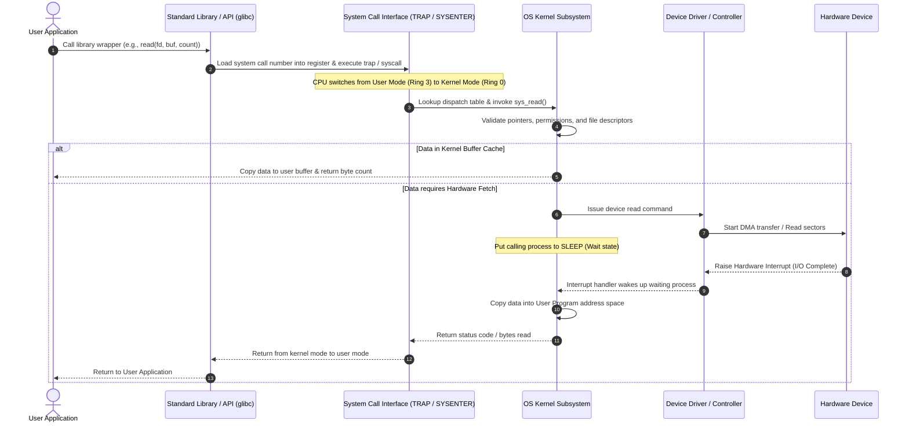

# SIMATS ENGINEERING
## ASSESSMENT TOOL 2 — CONCEPT MAPPING

**COURSE NAME:** Operating Systems  
**COURSE CODE:** CSA04  
**COURSE OUTCOME COVERED:** CO1: Apply the concepts of Operating System types, structures, and system calls to demonstrate their functions in various computing environments. (BL2, BL3)  
**QUESTIONS:** 1 (5 Comprehensive Concept Maps) | **Total Marks:** 100 | **Marks Scored:** 95/100  
**Submitted by:** Vishal Balaji J | **Register Number:** 192525014  
**Annexure A:** Concept Mapping  

---

### Code of Conduct
*I Vishal Balaji J (192525014) certify that this submission is my original work and that I have adhered to the guidelines specified for this assessment. I understand that any violation of academic integrity rules will result in disciplinary action.*  
**Signature of the student:** Vishal Balaji J  

---

## Question 1: Multi-Level Concept Map Integrating OS Types, Structures, System Calls, and Functions (BL2)

---

## Question 2: Comprehensive Interdependency Concept Map for Core Subsystems (BL3)

---

## Question 3: Comparative Concept Map — OS Paradigms (BL2)

---

## Question 4: Dynamic Execution Flow — User Program to Hardware & Response (BL3)

---

## Question 5: Hierarchical & Functional Taxonomy of System Calls (BL3)

```mermaid
graph TD
    SC["System Calls Classification"]

    %% Class 1: Process Control
    SC --> P["1. Process Control"]
    P --- P1["fork() : Create child process"]
    P --- P2["exec() : Load program into address space"]
    P --- P3["exit() : Terminate process"]
    P --- P4["wait() : Wait for child termination"]
    P --- P5["kill() : Send signal to process"]
    P -.->|"Maps to"| Srv_P["OS Process Scheduler & Dispatcher"]

    %% Class 2: File Management
    SC --> F["2. File Management"]
    F --- F1["open() : Allocate file descriptor"]
    F --- F2["read() : Fetch bytes from file"]
    F --- F3["write() : Write bytes to file"]
    F --- F4["lseek() : Reposition offset pointer"]
    F --- F5["close() : Release file descriptor"]
    F -.->|"Maps to"| Srv_F["VFS & File System Block Allocator"]

    %% Class 3: Device Management
    SC --> D["3. Device Management"]
    D --- D1["ioctl() : Device-specific I/O control"]
    D --- D2["read() / write() : Read/write device stream"]
    D --- D3["select() / poll() : Synchronous I/O multiplexing"]
    D -.->|"Maps to"| Srv_D["Device Drivers & Interrupt Service Routines"]

    %% Class 4: Information & Maintenance
    SC --> I["4. Information & Maintenance"]
    I --- I1["getpid() / getppid() : Query process identifiers"]
    I --- I2["time() : Get system wall clock"]
    I --- I3["sysinfo() : System memory and load stats"]
    I -.->|"Maps to"| Srv_I["Kernel Accounting & Performance Subsystems"]

    %% Class 5: Memory Management
    SC --> M["5. Memory Management"]
    M --- M1["brk() / sbrk() : Adjust process heap break"]
    M --- M2["mmap() : Map file/anonymous pages into virtual memory"]
    M --- M3["munmap() : Unmap virtual memory range"]
    M -.->|"Maps to"| Srv_M["Virtual Memory Manager & MMU Page Tables"]
```

