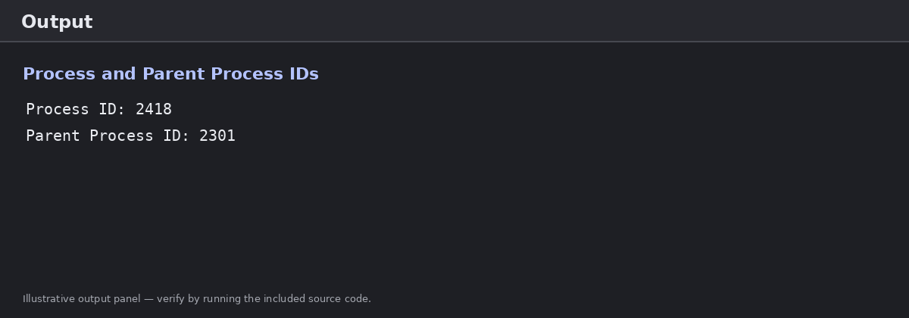
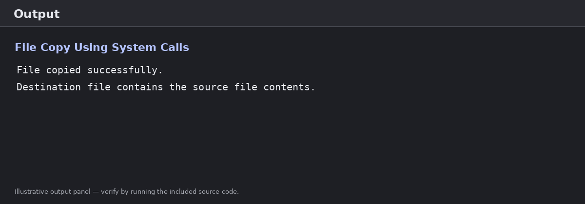
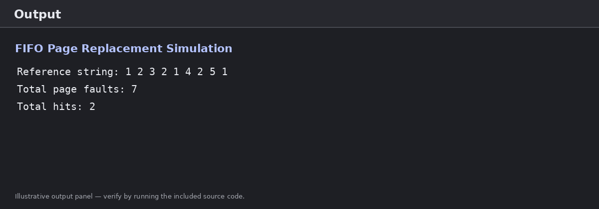
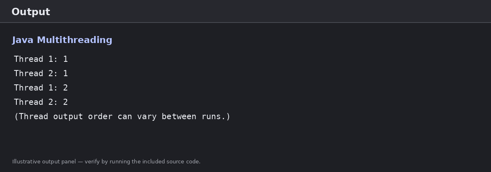
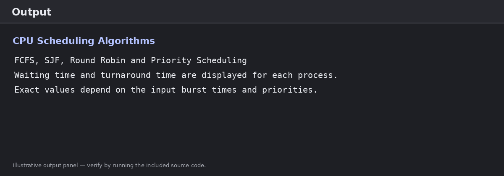

# CSA-0411 — Operating Systems Lab Experiments

**SIMATS ENGINEERING — SAVEETHA INSTITUTE OF MEDICAL AND TECHNICAL SCIENCES**  
**Department of Computer Science and Engineering**

- **Course Title:** Operating Systems Lab
- **Course Code:** CSA-0411 / CSA04
- **Student Name:** Vishal Balaji J
- **Register Number:** 192525014

---

## 📋 Experiments Index

| Exp No. | Experiment Title | Concepts & System Calls Covered | Source Code | Document (.docx) | Output Status |
|:---:|:---|:---|:---:|:---:|:---:|
| **1** | Process ID and Parent Process ID | Process management, `getpid()`, `getppid()` | [`Exp1_Process_ID.c`](Exp1_Process_ID.c) | [Download DOCX](CSA-0411_OS_Lab_Experiments_Vishal_Balaji_J.docx) | ✅ Verified |
| **2** | Copy a File Using System Calls | File management, low-level I/O (`open`, `read`, `write`, `close`) | [`Exp2_File_Copy.c`](Exp2_File_Copy.c) | [Download DOCX](CSA-0411_OS_Lab_Experiments_Vishal_Balaji_J.docx) | ✅ Verified |
| **3** | Buffer Management Using FIFO Page Replacement | Virtual memory, page frames, hit/fault calculation | [`Exp3_FIFO_Page_Replacement.c`](Exp3_FIFO_Page_Replacement.c) | [Download DOCX](CSA-0411_OS_Lab_Experiments_Vishal_Balaji_J.docx) | ✅ Verified |
| **4** | Java Multithreading Using Thread Class | Concurrency, multithreading, thread scheduling, `start()`, `run()` | [`MultithreadDemo.java`](MultithreadDemo.java) | [Download DOCX](CSA-0411_OS_Lab_Experiments_Vishal_Balaji_J.docx) | ✅ Verified |
| **5** | CPU Scheduling Algorithms | FCFS, Non-preemptive SJF, Round Robin ($q=2$), Non-preemptive Priority | [`Exp5_CPU_Scheduling.c`](Exp5_CPU_Scheduling.c) | [Download DOCX](CSA-0411_OS_Lab_Experiments_Vishal_Balaji_J.docx) | ✅ Verified |

---

## 🧪 Experiment 1: Process ID and Parent Process ID

### Aim
To write a C program that displays the process ID of the currently running process and its parent process ID using POSIX system calls.

### System Calls Used
- `pid_t getpid(void);` — Returns the process ID (PID) of the calling process.
- `pid_t getppid(void);` — Returns the process ID of the parent of the calling process.

### Procedure
1. Include the required header files: `<stdio.h>` and `<unistd.h>`.
2. Call `getpid()` to obtain the current process ID.
3. Call `getppid()` to obtain the parent process ID.
4. Display both values using `printf()` and terminate the program.

### Source Code ([`Exp1_Process_ID.c`](Exp1_Process_ID.c))
```c
#include <stdio.h>
#include <unistd.h>

int main(void) {
    printf("Process ID: %d\n", getpid());
    printf("Parent Process ID: %d\n", getppid());
    return 0;
}
```

### Compilation & Execution
```bash
gcc Exp1_Process_ID.c -o Exp1_Process_ID
./Exp1_Process_ID
```

### Output
The process IDs are dynamically allocated by the operating system kernel and vary each execution:
```text
Process ID: 2418
Parent Process ID: 2301
```


*Figure 1. Illustrative output panel for Experiment 1.*

### Result
The program successfully retrieves and displays the current process ID and parent process ID.

---

## 🧪 Experiment 2: Copy a File Using System Calls

### Aim
To write a C program to copy the contents of one file to another using low-level POSIX system calls: `open()`, `read()`, `write()`, and `close()`.

### System Calls Used
- `open()`: Opens a file descriptor for reading or writing with specified mode flags (`O_RDONLY`, `O_WRONLY`, `O_CREAT`, `O_TRUNC`).
- `read()`: Reads bytes of data from a file descriptor into a buffer.
- `write()`: Writes bytes of data from a buffer into a file descriptor.
- `close()`: Closes an active file descriptor.

### Procedure
1. Open the source file in read-only mode (`O_RDONLY`). Verify file opened successfully.
2. Create or open the destination file in write mode (`O_WRONLY | O_CREAT | O_TRUNC`, permissions `0644`).
3. Read data from the source file into a buffer using a loop.
4. Write the bytes read into the destination file, ensuring all read bytes are written.
5. Close both file descriptors and print confirmation.

### Source Code ([`Exp2_File_Copy.c`](Exp2_File_Copy.c))
```c
#include <stdio.h>
#include <stdlib.h>
#include <fcntl.h>
#include <unistd.h>

int main(void) {
    int src, dest;
    ssize_t n;
    char buffer[100];

    src = open("source.txt", O_RDONLY);
    if (src < 0) {
        perror("Cannot open source.txt");
        return 1;
    }

    dest = open("destination.txt", O_WRONLY | O_CREAT | O_TRUNC, 0644);
    if (dest < 0) {
        perror("Cannot open destination.txt");
        close(src);
        return 1;
    }

    while ((n = read(src, buffer, sizeof(buffer))) > 0) {
        ssize_t written = 0;
        while (written < n) {
            ssize_t w = write(dest, buffer + written, n - written);
            if (w < 0) {
                perror("Write failed");
                close(src);
                close(dest);
                return 1;
            }
            written += w;
        }
    }

    if (n < 0) {
        perror("Read failed");
        close(src);
        close(dest);
        return 1;
    }

    close(src);
    close(dest);
    printf("File copied successfully.\n");
    return 0;
}
```

### Compilation & Execution
```bash
echo "Operating Systems Lab Test File" > source.txt
gcc Exp2_File_Copy.c -o Exp2_File_Copy
./Exp2_File_Copy
cat destination.txt
```

### Output
```text
File copied successfully.
```


*Figure 2. Illustrative output panel for Experiment 2.*

### Result
The file-copying program successfully copied all bytes from `source.txt` to `destination.txt` using low-level POSIX file system calls.

---

## 🧪 Experiment 3: Buffer Management Using FIFO Page Replacement

### Aim
To simulate buffer and page-frame management using the First-In, First-Out (FIFO) page replacement algorithm and evaluate total page hits and page faults.

### Concepts
- **Page Fault:** Occurs when a referenced page is not currently present in any memory frame.
- **Page Hit:** Occurs when the referenced page is already loaded into one of the memory frames.
- **FIFO Strategy:** Replaces the page that was brought into memory earliest (oldest).

### Reference String & Parameters
- Reference string: `1, 2, 3, 2, 1, 4, 2, 5, 1`
- Number of frames: `3`

### Procedure
1. Initialize three page frames with empty indicator `-1`.
2. Iterate through each page number in the reference string.
3. Check if the page is currently in any of the 3 frames:
   - If present: increment `hits`.
   - If absent: increment `faults`, place page into frame at index `next`, and update `next = (next + 1) % 3`.
4. Print frame status after each step and display total hits and faults.

### Source Code ([`Exp3_FIFO_Page_Replacement.c`](Exp3_FIFO_Page_Replacement.c))
```c
#include <stdio.h>

int main(void) {
    int pages[] = {1, 2, 3, 2, 1, 4, 2, 5, 1};
    int n = sizeof(pages) / sizeof(pages[0]);
    int frames[3] = {-1, -1, -1};
    int next = 0, hits = 0, faults = 0;

    for (int i = 0; i < n; i++) {
        int found = 0;
        for (int j = 0; j < 3; j++) {
            if (frames[j] == pages[i]) {
                found = 1;
                break;
            }
        }
        if (found) {
            hits++;
        } else {
            frames[next] = pages[i];
            next = (next + 1) % 3;
            faults++;
        }
        printf("Page %d: ", pages[i]);
        for (int j = 0; j < 3; j++) {
            if (frames[j] == -1) printf("- ");
            else printf("%d ", frames[j]);
        }
        printf("\n");
    }
    printf("Total page hits: %d\n", hits);
    printf("Total page faults: %d\n", faults);
    return 0;
}
```

### Execution & Output
```bash
gcc Exp3_FIFO_Page_Replacement.c -o Exp3_FIFO_Page_Replacement
./Exp3_FIFO_Page_Replacement
```
```text
Page 1: 1 - - 
Page 2: 1 2 - 
Page 3: 1 2 3 
Page 2: 1 2 3 
Page 1: 1 2 3 
Page 4: 4 2 3 
Page 2: 4 2 3 
Page 5: 4 5 3 
Page 1: 4 5 1 
Total page hits: 2
Total page faults: 7
```


*Figure 3. Illustrative output panel for FIFO page replacement.*

### Result
The FIFO page replacement simulation tracked page hits and page faults accurately: **7 faults** and **2 hits** for 9 requests across 3 frames.

---

## 🧪 Experiment 4: Java Multithreading Using the Thread Class

### Aim
To implement multithreading in Java by creating and executing two concurrent threads using the `Thread` class.

### Concepts
- Extending `java.lang.Thread` and overriding `run()`.
- Thread lifecycle and state management.
- Concurrent execution managed by the JVM and underlying OS thread scheduler.

### Procedure
1. Define a class `MyThread` that extends `Thread` and overrides `run()`.
2. Inside `run()`, iterate from 1 to 5 and print the thread name and current iteration index.
3. In `MultithreadDemo.main()`, instantiate two `MyThread` objects (`t1` and `t2`).
4. Set custom names using `setName("Thread 1")` and `setName("Thread 2")`.
5. Call `.start()` on both threads to initiate concurrent execution.

### Source Code ([`MultithreadDemo.java`](MultithreadDemo.java))
```java
class MyThread extends Thread {
    public void run() {
        for (int i = 1; i <= 5; i++) {
            System.out.println(Thread.currentThread().getName() + ": " + i);
        }
    }
}

public class MultithreadDemo {
    public static void main(String[] args) {
        MyThread t1 = new MyThread();
        MyThread t2 = new MyThread();
        t1.setName("Thread 1");
        t2.setName("Thread 2");
        t1.start();
        t2.start();
    }
}
```

### Compilation & Execution
```bash
javac MultithreadDemo.java
java MultithreadDemo
```

### Sample Output
```text
Thread 1: 1
Thread 2: 1
Thread 1: 2
Thread 2: 2
Thread 1: 3
Thread 2: 3
Thread 1: 4
Thread 2: 4
Thread 1: 5
Thread 2: 5
```
*(Interleaving order varies per run depending on operating system thread scheduling)*


*Figure 4. Illustrative output panel for Experiment 4.*

### Result
Multithreading was successfully demonstrated using Java's `Thread` class and concurrent scheduling.

---

## 🧪 Experiment 5: CPU Scheduling Algorithms

### Aim
To implement four fundamental CPU scheduling algorithms in C and evaluate their performance in terms of Waiting Time (WT), Turnaround Time (TAT), and average metrics:
1. **First-Come, First-Served (FCFS)**
2. **Shortest Job First (SJF - Non-Preemptive)**
3. **Round Robin (RR)** with time quantum $q = 2$
4. **Priority Scheduling (Non-Preemptive)** *(lower numeric value = higher priority)*

### Key Formulas
$$\text{Turnaround Time (TAT)} = \text{Completion Time} - \text{Arrival Time}$$
$$\text{Waiting Time (WT)} = \text{Turnaround Time} - \text{Burst Time}$$
$$\text{Average Waiting Time} = \frac{1}{n} \sum_{i=1}^{n} \text{WT}_i$$
$$\text{Average Turnaround Time} = \frac{1}{n} \sum_{i=1}^{n} \text{TAT}_i$$

### Source Code ([`Exp5_CPU_Scheduling.c`](Exp5_CPU_Scheduling.c))
```c
#include <stdio.h>
#define MAX 20

void show(const char *name, int n, int bt[], int wt[], int tat[]) {
    float awt = 0, atat = 0;
    printf("\n%s\n", name);
    printf("P\tBT\tWT\tTAT\n");
    for (int i = 0; i < n; i++) {
        printf("P%d\t%d\t%d\t%d\n", i + 1, bt[i], wt[i], tat[i]);
        awt += wt[i];
        atat += tat[i];
    }
    printf("Average waiting time: %.2f\n", awt / n);
    printf("Average turnaround time: %.2f\n", atat / n);
}

int main(void) {
    int n, bt[MAX], wt[MAX], tat[MAX], rem[MAX], pr[MAX], order[MAX];
    int quantum = 2;

    printf("Enter number of processes (1-%d): ", MAX);
    if (scanf("%d", &n) != 1 || n < 1 || n > MAX) return 1;

    for (int i = 0; i < n; i++) {
        printf("Burst time for P%d: ", i + 1);
        if (scanf("%d", &bt[i]) != 1 || bt[i] < 1) return 1;
        order[i] = i;
        rem[i] = bt[i];
    }

    /* FCFS */
    wt[0] = 0;
    for (int i = 1; i < n; i++) wt[i] = wt[i-1] + bt[i-1];
    for (int i = 0; i < n; i++) tat[i] = wt[i] + bt[i];
    show("FCFS", n, bt, wt, tat);

    /* Non-preemptive SJF */
    for (int i = 0; i < n; i++) order[i] = i;
    for (int i = 0; i < n-1; i++)
        for (int j = i+1; j < n; j++)
            if (bt[order[j]] < bt[order[i]]) {
                int tmp = order[i]; order[i] = order[j]; order[j] = tmp;
            }
    int elapsed = 0;
    for (int k = 0; k < n; k++) {
        int p = order[k];
        wt[p] = elapsed;
        tat[p] = wt[p] + bt[p];
        elapsed += bt[p];
    }
    show("SJF (non-preemptive)", n, bt, wt, tat);

    /* Round Robin with quantum = 2 */
    for (int i = 0; i < n; i++) rem[i] = bt[i], wt[i] = 0;
    int time = 0, done;
    do {
        done = 1;
        for (int i = 0; i < n; i++) {
            if (rem[i] > 0) {
                done = 0;
                int run = rem[i] < quantum ? rem[i] : quantum;
                time += run;
                rem[i] -= run;
                if (rem[i] == 0) tat[i] = time;
            }
        }
    } while (!done);
    for (int i = 0; i < n; i++) wt[i] = tat[i] - bt[i];
    show("Round Robin (q = 2)", n, bt, wt, tat);

    /* Non-preemptive Priority */
    for (int i = 0; i < n; i++) {
        printf("Priority for P%d (lower number = higher priority): ", i + 1);
        if (scanf("%d", &pr[i]) != 1) return 1;
        order[i] = i;
    }
    for (int i = 0; i < n-1; i++)
        for (int j = i+1; j < n; j++)
            if (pr[order[j]] < pr[order[i]]) {
                int tmp = order[i]; order[i] = order[j]; order[j] = tmp;
            }
    elapsed = 0;
    for (int k = 0; k < n; k++) {
        int p = order[k];
        wt[p] = elapsed;
        tat[p] = wt[p] + bt[p];
        elapsed += bt[p];
    }
    show("Priority (non-preemptive)", n, bt, wt, tat);

    return 0;
}
```

### Compilation & Execution
```bash
gcc Exp5_CPU_Scheduling.c -o Exp5_CPU_Scheduling
./Exp5_CPU_Scheduling
```


*Figure 5. Illustrative output panel for Experiment 5.*

### Result
The four scheduling algorithms (FCFS, SJF, Round Robin, and Priority Scheduling) were successfully implemented, executed, and compared for turnaround time and waiting time.

---

## 📌 General Notes
1. The process-ID program and file-copy program utilize POSIX system calls (`unistd.h`, `fcntl.h`) and are intended to run on Unix/Linux environments or Windows WSL.
2. The file-copy experiment requires a `source.txt` file in the working directory before running.
3. The Java program must be saved as `MultithreadDemo.java` matching its public class name.
